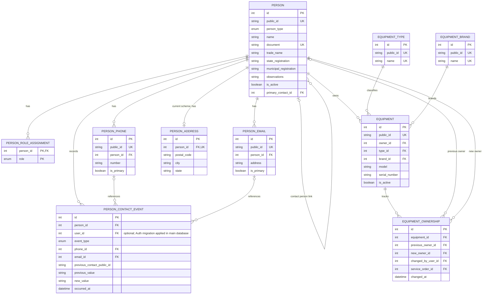
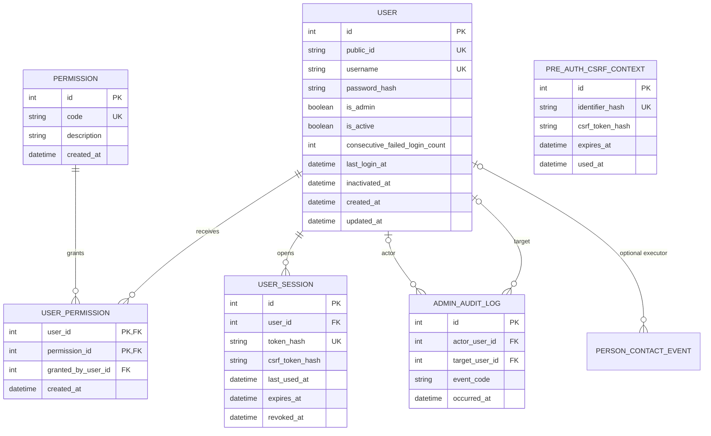
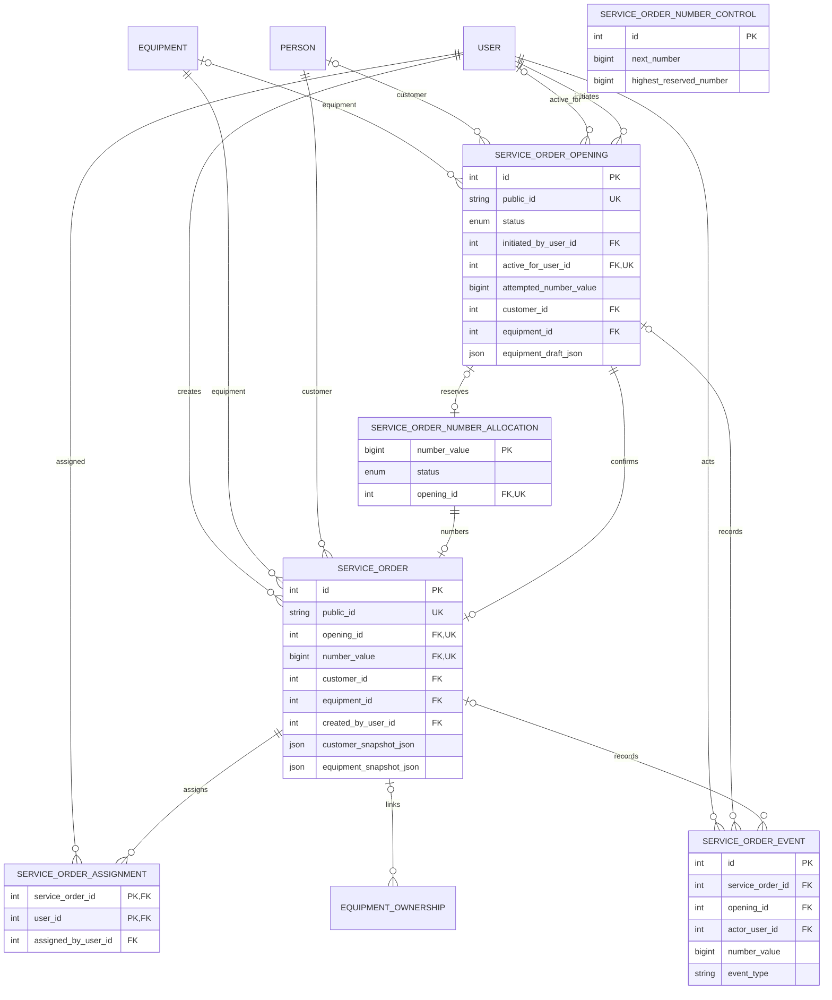

# Diagrama de Entidades

## Objetivo

Apresentar os relacionamentos já aplicados no banco principal, incluindo a base do Recorte 1 de OS. Os diagramas resumem as relações principais; cinco endpoints de abertura estão implementados no Backend, enquanto os demais fluxos de OS continuam pendentes.

## Status

O banco principal `gestor_os`, em MySQL Community Server 8.0.46, tem cinco migrations aplicadas, até `20261008180000_service_order_foundation`. A migration de OS passou em banco isolado vazio e em cópia restaurada do principal antes do deploy autorizado. As seis tabelas de OS, seus índices e FKs e o CHECK singleton foram conferidos no principal; o seed posterior das oito permissões de OS foi executado duas vezes, resultando em 32 permissões sem duplicidade. `equipment.transfer_ownership` permanece única. O diagrama de OS abaixo mostra a base física aplicada. O Backend já implementa iniciar, consultar a própria abertura ativa, consultar por `publicId`, editar por `PATCH` e cancelar a abertura; a confirmação em OS oficial e os demais fluxos de OS ainda estão pendentes.

## Última atualização

11/10/2026.

## Diagrama

## Schema Prisma de autenticação e autorização — migration aplicada no banco principal

O primeiro recorte Auth foi implementado no Backend, já versionado localmente, ainda não enviado a origin. O schema Prisma e a migration `20261008120000_auth_foundation` criada definem as entidades abaixo, e essa migration foi aplicada ao banco principal. A validação funcional ocorreu em banco isolado/shadow por SQL direto, sem registrar a migration em `_prisma_migrations` do shadow. `USER_SESSION` controla timeout de 8 horas por inatividade, renovado a cada requisição autenticada válida via `last_used_at`, sem limite absoluto; guarda apenas hash do segredo e estado de revogação. `ADMIN_AUDIT_LOG` tem retenção inicialmente indefinida e sem exclusão automática. Usuários devem ser inativados, não excluídos fisicamente. A FK opcional de `PERSON_CONTACT_EVENT` usa `ON DELETE SET NULL`.

`PreAuthCsrfContext` é o armazenamento físico temporário do contexto CSRF pré-login, sem vínculo com `USER`: contém hashes do identificador e token, timestamps de criação/expiração/uso e metadados técnicos. `PERSON_CONTACT_EVENT.user_id` é opcional; eventos anteriores permanecem com `NULL`. A migration aplicada estabeleceu a FK com `ON DELETE SET NULL`.

O username é obrigatório e único, normalizado por `trim`, armazenado em minúsculas, com 3 a 50 caracteres e regex `^[a-z0-9._-]{3,50}$`; e-mail de Pessoa não é login. Os campos mostrados em `USER` correspondem ao schema Prisma; senhas têm mínimo de 10 caracteres e são processadas com Argon2id via `argon2`. O primeiro recorte não tem CRUD HTTP de usuários e o uso inicial fica restrito ao Administrador bootstrapado. Sessões são opacas, revogáveis e expiram após 8 horas de inatividade, renovadas a cada requisição autenticada válida por `last_used_at`, sem limite absoluto; somente o hash do segredo é persistido. Logout revoga apenas a sessão atual. Permissões são diretas por usuário, sem perfis rígidos; `isAdmin` representa autoridade máxima, sem `admin.full`, `system.admin` ou Master. Falhas são contadas por username normalizado, inclusive inexistente: ao atingir cinco registra evento sem bloquear a conta; sucesso zera o contador existente e username inexistente não cria usuário/contador persistente. A notificação inicial é somente pelo Log Administrativo, sem e-mail. O bootstrap local criou um Administrador ativo; uma segunda execução foi validada para abortar antes de solicitar credenciais se já existe Administrador ativo. A transação mantém o controle concorrente no código, mas uma corrida real entre processos ainda não foi testada. Essas regras comportamentais são políticas de aplicação, não todas constraints físicas. Não há endpoints de inativação/rebaixamento de Administrador neste recorte; a proteção do último Administrador precisa ser validada quando essas operações forem implementadas.

`PERSON_CONTACT_EVENT.user_id` está no schema Prisma e na migration Auth criada, com vínculo opcional ao usuário executor; eventos antigos permanecem sem usuário e a gravação do ator é atômica com a alteração do contato. A migration foi aplicada no banco principal.

## Base física de OS — migration aplicada no banco principal

As seis tabelas abaixo foram criadas por `20261008180000_service_order_foundation`. `equipment` recebeu `is_active`, Marca e Modelo obrigatórios; `equipment_ownership_events` recebeu usuário executor e vínculo opcional com OS. O contador foi inicializado com `(id, next_number, highest_reserved_number) = (1, 1, 0)`. Este diagrama mostra a estrutura, não a implementação dos fluxos operacionais.

## Observações

- Os diagramas mostram relações e restrições principais; os campos completos estão em `docs/modelagem/Modelo-Banco.md` e `backend/prisma/schema.prisma`.
- `equipment.serial_number` é opcional e possui índice não unique no schema atual. A regra funcional mais recente bloqueia serial repetido para o mesmo proprietário atual e avisa sem bloquear quando o proprietário é diferente; a aplicação deverá aplicar essa validação. Não há unicidade global de serial.
- **Modelo físico atual:** `person_addresses.person_id` é único, então o banco aplicado aceita no máximo um endereço por Pessoa. A regra funcional aprovada em 07/10/2026 permite vários endereços; a unicidade deverá ser removida e Tipo de Endereço/principalidade modelados em migration futura. O diagrama continua mostrando o schema atual, não a estrutura futura.
- Os catálogos funcionais iniciais aprovados em 07/10/2026 são Tipos de Contato (Cliente, Fornecedor, Transportadora, Prestador de Serviço, Parceiro), Tipos de Endereço (Principal, Cobrança, Entrega, Instalação) e Tipos de Contribuinte (Contribuinte ICMS, Contribuinte Isento, Não Contribuinte). Essas categorias ainda não correspondem a tabelas no schema/banco aplicado; o diagrama não as representa como entidades físicas existentes.
- O ciclo de vida de catálogos auxiliares ainda não está representado no schema. `document` informado possui unicidade; a API básica bloqueia documento repetido e, sem documento, avisa sem bloquear por nome normalizado idêntico. Comparações por telefone/e-mail continuam pendentes. Busca fuzzy está fora desta etapa. Catálogos usados poderão ser renomeados, com o nome atual no cadastro e o valor anterior/novo no histórico futuro.
- **Modelo físico atual:** `person_roles.role` é enum. A regra funcional aprovada define papéis como Tipos de Contato simultâneos provenientes de cadastro próprio; a estrutura atual é parcial e deverá ser revista.
- A relação física de Pessoa de Contato é opcional, autorreferenciada em `people` e permite no máximo uma pessoa vinculada a cada cadastro. A coluna existente se chama `primary_contact_id`; a nomenclatura funcional aprovada é Pessoa de Contato.
- Para equipamentos, Marca e Fabricante são o mesmo conceito e haverá um único cadastro, representado fisicamente por `equipment_brands`.
- Aviso permanece campo único futuro e não existe em `people`; pergunta, apresentação condicional, permissões e ausência de log de leitura são regras funcionais ainda não implementadas. Administrador tem poderes máximos; permissões individuais podem conceder ação equivalente a outro usuário. Master não existe.
- `people.is_active` existe no schema, mas a regra funcional proíbe excluir Pessoa fisicamente; somente Administrador ou usuário com permissão equivalente pode inativar/reativar. Pessoa inativa é consultável, mas não pode ser usada em novos vínculos operacionais. Equipamento só pode ser excluído sem qualquer registro persistido relacionado e com autorização correspondente; com vínculo, só pode ser inativado/reativado. `equipment.is_active` já existe no schema Prisma e no banco principal e aparece no diagrama de Equipamento.
- `equipment.owner_id` referencia uma Pessoa sem exigir no schema que ela tenha Tipo de Contato Cliente ou esteja ativa. A validação funcional será necessária no cadastro e em transferência.
- A Pessoa informada pelo nome no atendimento é cliente da OS e proprietário operacional do equipamento para aquela abertura. Se o equipamento estiver ligado a outra Pessoa, exigir escolha explícita entre cancelar, abrir para o titular atual ou transferir com permissão; portador não é controlado. Cada OS confirmada terá retrato histórico cadastral parcial, imutável e consultável no histórico; tela e impressão padrão usarão dados atuais. O primeiro recorte armazenará o retrato em campos JSON próprios sugeridos `customerSnapshotJson` e `equipmentSnapshotJson`, separados dos vínculos atuais, com valores textuais principais, `snapshotVersion: 1` e `capturedAt` na confirmação. A entidade OS e esses campos JSON já existem no schema Prisma, no principal e no diagrama de OS; o mecanismo geral de histórico continua futuro.
- **Retrato cadastral e correção de vínculos — regras aprovadas:** captura única na confirmação, nunca durante abertura em andamento, com dados principais indicados em `docs/02-Regras-de-Negocio.md`. Reabertura e correção do cliente/equipamento não recriam o retrato. A correção pós-confirmação exige Administrador ou permissão específica futura sugerida (`os.correct_customer`, `os.correct_equipment`) e gera histórico obrigatório; o número permanece. A consulta do retrato é permitida a quem pode visualizar a OS. Não há impressão própria nem aviso automático obrigatório de divergência. Checklist/recebimento físico é separado. Os campos JSON e o formato interno inicial do snapshot estão aprovados; a base de OS e seus campos JSON existem no schema Prisma e na migration aplicada ao principal; os demais campos físicos, a API e migrations posteriores continuam futuros.
- **Correção administrativa de vínculo — complemento aprovado:** motivo não é obrigatório; correção pode ocorrer em OS FECHADA/CANCELADA e não reabre a OS nem altera status, número, retrato, faturamento, cobrança, pagamento ou estoque. Registros financeiros vinculados não são alterados automaticamente. Alterações de cliente/equipamento exigem validação de titularidade e escolha explícita; transferência exige Administrador ou `equipment.transfer_ownership`, nunca ocorre em silêncio. Se os dois vínculos forem corrigidos juntos, a operação é atômica. Não há alerta automático obrigatório no painel do Administrador. O modelo físico ainda não está aprovado.
- **Numeração e abertura — regras aprovadas:** número visível `OS-` + seis dígitos, sequência global, crescente, única e imutável, gerada antes da confirmação. A abertura em andamento fica persistida, sobrevive a reinício, não é atendimento ativo e não possui snapshot; cada usuário pode ter uma por vez. Usuário comum só retoma/cancela a própria; Administrador ou `service_orders.opening.manage` pode atuar em outra, com evento de auditoria. A confirmação com cliente/equipamento cria OS ABERTA/TRIAGEM. Edições temporárias não exigem histórico detalhado; eventos principais são registrados; não há expiração automática obrigatória no Recorte 1. Aberturas em andamento/canceladas não aparecem na listagem comum. Abandono libera número conforme a regra de sequência ou registra ABERTURA CANCELADA; etiqueta não consome o número. O schema Prisma já contém OS, abertura e sequenciador; a migration passou em banco restaurado e foi aplicada ao principal. O diagrama de OS mostra essa estrutura.
- **OS, mudanças de status e reabertura — regras funcionais aprovadas:** situação operacional e status macro são distintos; após TRIAGEM, a situação pode mudar livremente por usuário autorizado. FECHADA/CANCELADA exigem Administrador ou permissão específica; transições diretas entre elas são proibidas. Reabertura simples é textual. Reabertura completa mantém o número e retorna a ABERTA/AGUARDANDO AVALIAÇÃO/ORÇAMENTO, cancela faturamento/pagamentos do ativo com histórico, move peças vinculadas para ORÇADA e notifica o Administrador; pode reabrir OS CANCELADA. As situações, atribuições padrão, resultados e regra de orçamento em NÃO AUTORIZADO estão em `docs/02-Regras-de-Negocio.md`. O schema Prisma contém a base de OS e eventos do Recorte 1, ainda sem os fluxos e relações de reabertura, financeiro e estoque descritos aqui. O diagrama de OS mostra a base física aplicada.
- **Equipamento comprado/Doado — fluxo aprovado para etapa posterior:** OS externa fica FECHADA; equipamento passa à Pessoa da própria empresa e gera OS interna ABERTA/TRIAGEM ligada reciprocamente. Informações da origem são herdadas em área histórica separada; cobranças, pagamentos, serviços cobrados, peças UTILIZADAS/BAIXADAS e pendências não se tornam itens ativos. Só Administrador configura a Pessoa, que deve ser elegível como titular; sem configuração, bloqueia o encerramento. A original não recebe movimentação técnica depois da nova OS e só admite reabertura simples. A interna não pode repetir esse resultado. O schema Prisma contém a base de OS, mas não a configuração da Pessoa da empresa, vínculos recíprocos entre OS ou histórico herdado; o diagrama de OS mostra somente a base física atual. Não se aprova modelo físico adicional para esse fluxo. Atomicidade, herança, efeitos fiscais/financeiros e reconciliações de estoque permanecem pendentes.
- **Peças e valores de itens em OS — decisões funcionais aprovadas:** DISPONÍVEL/ORÇADA/UTILIZADA/BAIXADA aplicam-se somente à peça controlada pelo estoque; peça avulsa fica fora do estoque e não é conversível. O valor cobrado de peça de estoque, peça avulsa, serviço/mão de obra ou outro item pode ser alterado por usuário autorizado após aprovação, sem nova aprovação do cliente, bloqueio automático ou motivo obrigatório. A aprovação não congela valores. Cada alteração registra usuário, data/hora, OS, item, tipo, campo e valores anterior/novo. Usuários autorizados na OS também podem visualizar e alterar o custo interno da peça avulsa após aprovação, mantendo histórico. `finance.os_costs.manage` pode ser avaliada futuramente para relatórios, fechamento ou controle mais restrito, sem ser requisito operacional. O diagrama/schema não contém itens de OS nem histórico financeiro de alterações; não se aprova estrutura física nesta etapa.
- `equipment_ownership_events` existe para eventos de titularidade. Transferência altera titular atual, registra evento e não reescreve OS antigas; pode ocorrer fora ou durante OS, com associação opcional à OS. Usuários autorizados podem alterar cadastros e transferir mesmo com histórico, sem justificativa obrigatória; as mudanças devem gerar histórico automaticamente. O banco principal não registra tipos gerais de histórico ou justificativa; usuário executor e vínculo opcional com OS já existem no schema Prisma e no principal.
- O sistema terá histórico geral por entidade, conceitualmente com alteração de campo e evento/movimentação, valores anterior/novo quando aplicável, entidade, data/hora e usuário quando disponível. A estrutura física, lista final de eventos, classificação de acesso e filtros permanecem pendentes. O schema Prisma já contém a base de OS e a chave opcional para vincular transferência; ambos já foram aplicados ao banco principal. O primeiro fluxo de abertura está implementado no Backend; confirmação e demais fluxos funcionais continuam pendentes.
- Telefone, e-mail e endereço admitem no máximo um principal por Pessoa e coleção, sem exigir que exista principal; marcar outro desmarca o anterior. Índices funcionais aplicados garantem principalidade única para telefones e e-mails. Vários endereços do mesmo Tipo são permitidos funcionalmente, mas o schema ainda restringe endereço a zero ou um por Pessoa.
- **Contatos implementados:** a migration `20261007183000_person_contacts` adiciona `public_id` único a telefones/e-mails, unicidade de e-mail por Pessoa, índices funcionais de principalidade e a tabela `person_contact_events`. As rotas diretas de `POST`/`GET` são descritas em `docs/04-API.md`; `label` permanece fora da API, sem edição/remoção/inativação e sem rota de histórico. A inclusão exige confirmação cadastral; telefone não padrão até 32 dígitos exige confirmação específica. E-mail segue a gramática ASCII documentada na API. As operações persistem contato, principalidade e eventos na mesma transação. A tabela de eventos não possui CHECK físico para XOR entre `phone_id`/`email_id` ou coerência de `event_type`; o service valida essas combinações. As rotas estão protegidas por Auth no código, a migration foi aplicada no banco principal e os principais testes autenticados locais passaram. Testes funcionais específicos de criação e autoria de evento ainda estão pendentes.
- Catálogos iniciais serão carregados por seed idempotente sob comando controlado, sem execução automática ao iniciar o Backend; a estratégia técnica de identificadores e preservação de alterações será definida na implementação.
- Regra de serial aprovada: repetição para o mesmo proprietário atual bloqueia; para proprietário diferente avisa e permite cadastro, sem sugerir transferência. Sem serial, salva sem busca automática por proprietário + Tipo + Marca + Modelo. Serial é armazenado em caixa alta sem remover símbolos ou alterar espaços, inclusive no início/fim; `ABC-123` e `ABC123` são diferentes. Pesquisa de equipamentos é independente de duplicidade: localiza por proprietário/Pessoa/Cliente, Tipo, Marca, Modelo, serial e Status; Modelo aceita texto, serial aceita busca exata ou parcial, Status permite Ativo/Inativo/Todos e inativos ficam ocultos por padrão. Detalhes de pesquisa avançada/filtros combinados permanecem pendentes.
- Equipamento exige funcionalmente Proprietário, Tipo de Equipamento, Marca, Modelo e Status; serial é opcional. O schema e o banco atuais exigem `brand_id` e `model` e incluem `equipment.is_active` para o status Ativo/Inativo. Status funcionais são apenas Ativo/Inativo, com novo Equipamento Ativo; estados adicionais estão fora desta etapa.
- `equipment_types` e `equipment_brands` não possuem status no schema atual. A regra funcional permite exclusão física apenas antes do uso; usados podem ser editados/inativados, mas não apagados, e inativos não são opções padrão em novos Equipamentos. Renomeação após uso é permitida: o catálogo mantém o nome atual e o histórico registra nome anterior/novo, data/hora e usuário quando disponível; snapshots em cada referência não serão adotados.
- Tipo de Equipamento e Marca possuem catálogos iniciais aprovados como cadastros próprios expansíveis, não enums fixos; serão carregados por seed idempotente sob comando controlado, sem execução automática no startup. Regra geral de caixa alta, e-mail minúsculo com trim, telefone/CEP numéricos e pesquisa são comportamentos de aplicação. Telefone com 10 dígitos é aceito como fixo; com 11, como celular se o primeiro após DDD for 9; outros formatos entre 1 e 32 dígitos geram aviso não bloqueante com possibilidade de confirmar. Sem dígitos ou acima de 32, bloqueia no recorte aprovado. Na ficha, usuário autorizado pode alterar dados com ou sem histórico, sem justificativa obrigatória; mudanças são registradas automaticamente. Proprietário com histórico exige transferência formal. Isso não altera o ciclo de vida dos cadastros auxiliares de Tipo e Marca.
- Usuário com permissão correspondente pode consultar histórico operacional básico de Pessoa, Equipamento e OS; Administrador pode consultar o histórico completo. Histórico do Aviso e histórico técnico/auditoria exigem Administrador ou permissão explícita equivalente. O schema Prisma/migration atual não contém essa estrutura, não impõe a matriz de permissões e não implementa a confirmação antes de salvar.
- `people.person_type` PF/PJ é obrigatório e sem default; Nome/Razão Social também é obrigatório. Nome Fantasia, inscrições e Observações já existem como campos opcionais. Tipo de Contribuinte e Aviso, assim como os cadastros próprios de Tipo de Contato, Tipo de Contribuinte e Tipo de Endereço, continuam ausentes do schema.
- `document` é opcional e unique no modelo físico. A API básica valida CPF numérico e CNPJ numérico ou alfanumérico oficial, normaliza o valor canônico, confere compatibilidade com PF/PJ e bloqueia duplicidade. `VARCHAR(14)` comporta os 14 caracteres do CNPJ. A coluna por si só não impõe cálculo dos dígitos, normalização ou compatibilidade; essas validações são realizadas no Backend.
- Nome Fantasia não se aplica a PF, é opcional para PJ e a Razão Social serve como referência de exibição quando ausente. IE/IM são opcionais, principalmente para PJ, e não terão validação estadual/municipal nesta etapa. Tipo de Contribuinte é opcional no cadastro geral e necessário na emissão de nota fiscal; regras fiscais completas continuam pendentes.
- As migrations inicial, de Pessoa básica, de contatos, de Auth e de OS foram aplicadas. As demais decisões funcionais descritas neste documento continuam pendentes.
- Auth está implementado no Backend, e a migration `20261008120000_auth_foundation` está aplicada no banco principal. O seed inicial de 24 permissões de Auth foi executado duas vezes sem duplicação; `admin.full`, `system.admin` e `Master` estão ausentes. O bootstrap criou um Administrador ativo; a segunda execução aborta antes de solicitar credenciais quando já há Administrador ativo. O controle transacional permanece no service, mas concorrência real de bootstrap não foi testada. Os principais testes HTTP autenticados locais confirmaram login, `/auth/me`, listagem paginada de Pessoas como Admin, CSRF, logout e rejeição da sessão revogada. As sete rotas de Pessoas exigem sessão/permissão. Frontend e CRUD HTTP de usuários seguem fora do recorte. Uma credencial administrativa foi exposta acidentalmente em teste manual; por decisão de Marcos não foi trocada agora, mas deverá ser substituída antes de uso real, rede compartilhada, produção ou demonstração externa; o fluxo definitivo de troca/reset segue pendente. O backend escuta somente em `127.0.0.1`; acesso externo segue proibido até 2FA e fronteira confiável. Vulnerabilidades high do `npm install` e a concessão MySQL antiga com `_` sem escape ainda precisam ser avaliadas/revisadas.

## Histórico de alterações

| Data | Alteração |
| --- | --- |
| 06/10/2026 | Primeiro diagrama do recorte de pessoas e equipamentos. |
| 07/10/2026 | Registro das regras funcionais aprovadas que divergem do modelo físico, incluindo campos obrigatórios de Pessoa e validação de CPF/CNPJ, sem representar migrations ainda não aplicadas. |
| 07/10/2026 | Complemento das observações com Aviso, exclusão/inativação, Pessoa informada na abertura da OS e titularidade, mantendo o diagrama limitado ao schema físico atual. |
| 07/10/2026 | Registro das regras aprovadas de serial, campos obrigatórios, status Ativo/Inativo e ciclo de vida de Tipo de Equipamento/Marca, sem alterar o diagrama físico atual. |
| 07/10/2026 | Registro dos catálogos iniciais de Tipo de Equipamento e Marca, normalização, pesquisa, alterações permanentes e vínculo opcional de transferência com OS, sem alterar o diagrama físico. |
| 07/10/2026 | Atualização do diagrama para refletir a migration de Pessoa básica já aplicada e separar os campos implementados das regras ainda pendentes. |
| 08/10/2026 | Registro da decisão de documento: CPF numérico; CNPJ numérico antigo ou alfanumérico oficial, canônico sem pontuação e em maiúsculas; schema/migration permanecem inalterados naquela atualização documental. |
| 07/10/2026 | Registro do recorte de contatos aplicado, incluindo eventos mínimos e índices de principalidade. |
| 08/10/2026 | Registro do contrato técnico final aprovado para contatos, histórico mínimo e integridade futura, sem alterar o diagrama físico aplicado. |
| 08/10/2026 | Inclusão do diagrama conceitual futuro de autenticação/autorização, separado do modelo físico implementado. |
| 08/10/2026 | Complemento conceitual DA-018 para username, falhas, CSRF pré-login, Administrador bootstrapado e autoria opcional de contatos; sem declarar tabelas implementadas. |
| 08/10/2026 | Complemento dos detalhes conceituais de sessão, retenção do Log Administrativo, inativação de usuário e FK opcional para autoria de contatos. |
| 08/10/2026 | Atualização do diagrama e do estado da migration Auth: schema Prisma criado, migration pendente no principal, incluindo `PreAuthCsrfContext` e autoria opcional de eventos. |
| 08/10/2026 | Migration Auth aplicada no banco principal; seis tabelas Auth e autoria opcional de eventos presentes, com seed de 24 permissões idempotente, primeiro Administrador criado e principais testes HTTP autenticados locais concluídos. |
